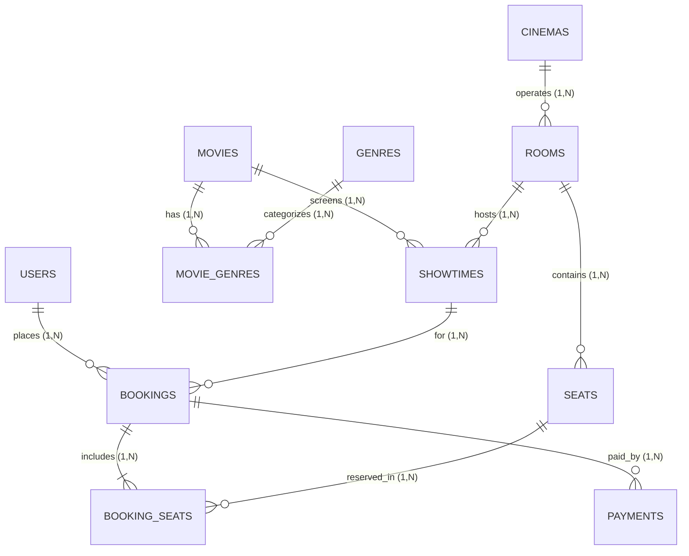

# BÁO CÁO ĐẶC TẢ CHỨC NĂNG MODULE & THIẾT KẾ CƠ SỞ DỮ LIỆU (ERD)
## DỰ ÁN: HỆ THỐNG ĐẶT VÉ XEM PHIM TRỰC TUYẾN (CINEMA BOOKING SYSTEM)

- **Họ và tên**: Lê Văn Hùng
- **Mã sinh viên**: B25DTCN289
- **Lớp**: HN-KS25-CNTT1
- **Phân hệ phụ trách**: **Module Quản trị hệ thống & Quản lý Phim (Admin Portal & Movie Management Module)**
- **Nhóm bảng thiết kế trực tiếp**: `movies`, `genres`, `movie_genres`, `users`
- **Ghép nối vào ERD chung 10 bảng của nhóm**: `users`, `movies`, `genres`, `cinemas`, `rooms`, `seats`, `showtimes`, `bookings`, `booking_seats`, `payments`.

---

## PHẦN 1: ĐẶC TẢ NGẮN CÁC CHỨC NĂNG MODULE PHỤ TRÁCH (SRS)

Căn cứ theo kế hoạch phân công Sprint và 9 nhiệm vụ (task) được giao, sinh viên đảm nhiệm phân hệ **Quản trị hệ thống & Quản lý Phim (Admin Portal & Movie Management)** với các chức năng chi tiết sau:

### 1.1. Bố cục Quản trị & Cơ chế Phân quyền (Admin Layout & Authorization)
- **Khung giao diện Admin Layout**:
  - Thiết kế layout chuyên biệt gồm Sidebar điều hướng cố định (Dashboard thống kê, Quản lý Phim, Rạp/Phòng, Suất chiếu, Đơn vé, Khách hàng) và Header chứa thông tin tài khoản Admin đang đăng nhập.
  - Phục vụ không gian làm việc tập trung cho ban quản trị rạp chiếu.
- **Bảo mật phân quyền phía Frontend (Route Guard)**:
  - Kiểm tra role của người dùng trong `localStorage`; nếu không phải `admin`, chặn tuyệt đối việc truy cập các trang `/pages/admin/*` và điều hướng ngay về trang Đăng nhập.
- **Bảo mật phân quyền phía Backend (Middleware/Dependency `require_admin`)**:
  - Triển khai middleware trên FastAPI để giải mã JWT Token trong Authorization Header. Bắt buộc kiểm tra `role == 'admin'`; nếu không đạt yêu cầu, trả về HTTP Status Code `403 Forbidden`.
- **Kịch bản khởi tạo dữ liệu mẫu (Database Seeding)**:
  - Xây dựng script tự động seed tài khoản admin mặc định (`admin@cinema.com`) và dữ liệu cụm rạp, phòng chiếu, lịch chiếu mẫu trong 7 ngày để cả nhóm phối hợp kiểm thử liên thông (End-to-End).

### 1.2. Phân hệ Quản lý Phim & Thể loại (Movie Management)
- **API Quản lý Phim (`/admin/movies`)**:
  - Cung cấp đầy đủ các thao tác Thêm mới, Chỉnh sửa thông tin phim, Đổi trạng thái hoặc Ngừng chiếu phim (chuyển status sang `ended`).
- **Kiểm thực dữ liệu nghiêm ngặt (Validation)**:
  - Thời lượng phim (`duration`) bắt buộc là số nguyên dương (> 0 phút).
  - Ngày khởi chiếu (`release_date`) bắt buộc nhập đúng định dạng `YYYY-MM-DD`.
  - Tên phim (`title`) không được để trống.
- **Gán thể loại cho phim**:
  - Quản lý danh mục thể loại (`genres`) và gán nhiều thể loại cho một bộ phim thông qua bảng trung gian `movie_genres` (quan hệ nhiều-nhiều).
- **Upload Poster & Xem trước hình ảnh (Preview)**:
  - API tiếp nhận ảnh định dạng `.jpg`, `.jpeg`, `.png`, giới hạn dung lượng tối đa 5MB, lưu file vào thư mục tĩnh `uploads/posters/` và trả về URL ảnh.
  - Form thêm/sửa phim có tính năng xem trước poster (Live Image Preview) ngay khi chọn ảnh từ máy.

### 1.3. Quản lý Đơn vé & Khách hàng phía Admin
- **Quản lý & Tra cứu Đơn vé**:
  - Hiển thị danh sách vé đã bán toàn hệ thống.
  - Bộ lọc đa tiêu chí theo phim, ngày chiếu, trạng thái vé (`pending`, `confirmed`, `cancelled`).
  - Hỗ trợ tìm kiếm nhanh theo **Mã vé** hoặc **Số điện thoại** người đặt.
  - Xem chi tiết đơn vé và hỗ trợ huỷ vé (đổi trạng thái đơn sang `cancelled` và giải phóng ghế).
- **Quản lý Khách hàng**:
  - Hiển thị danh sách người dùng đã đăng ký. Tìm kiếm theo tên/email/SĐT.
  - Chức năng **Khoá / Mở tài khoản** (cập nhật cờ `is_active = False/True`) để ngăn ngừa hành vi gian lận hoặc spam đơn vé.

### 1.4. Dashboard Thống kê & Báo cáo Doanh thu (Analytics)
- **Thẻ số liệu tổng quan (KPI Cards)**:
  - Hiển thị tổng doanh thu ngày/tháng, tổng số vé đã bán, tổng số phim đang chiếu, số lượng tài khoản mới.
- **Báo cáo chi tiết & Biểu đồ**:
  - Báo cáo doanh thu theo ngày và theo từng bộ phim cụ thể.
  - Thống kê tỷ lệ lấp đầy suất chiếu:
    $$	ext{Occupancy Rate} = rac{	ext{Số ghế đã đặt}}{	ext{Tổng số ghế của phòng chiếu}} 	imes 100\%$$
  - Trực quan hoá dữ liệu qua biểu đồ cột và biểu đồ tròn.

### 1.5. Kế hoạch Kiểm thử & Tích hợp (Testing & Delivery)
- Viết ma trận test cases: Kiểm thử dữ liệu đúng (Happy path), sai dữ liệu/thiếu trường bắt buộc, chưa đăng nhập, sai quyền (non-admin).
- Ghi nhận kết quả vào Test Log (Trạng thái Pass/Fail, bug phát hiện, tiến độ fix).
- Merge module vào nhánh chính, chạy luồng xuyên suốt đề tài, sửa lỗi phát sinh và chuẩn bị slide demo cho buổi bảo vệ đồ án.

---

## PHẦN 2: THIẾT KẾ CƠ SỞ DỮ LIỆU CÁC BẢNG CỦA MODULE PHỤ TRÁCH

Module trực tiếp phụ trách thiết kế và vận hành 4 bảng dữ liệu cốt lõi:

### 2.1. Bảng `movies` (Danh mục phim)
Lưu trữ thông tin chi tiết của các bộ phim chiếu tại rạp.

| Tên trường (Column) | Kiểu dữ liệu | Khoá | Ràng buộc | Ý nghĩa nghiệp vụ |
| :--- | :--- | :---: | :--- | :--- |
| `id` | `INT` | **PK** | AUTO_INCREMENT | Mã định danh duy nhất của phim |
| `title` | `VARCHAR(200)` | | NOT NULL | Tên tác phẩm phim |
| `description` | `TEXT` | | NULLABLE | Nội dung tóm tắt phim |
| `duration` | `INT` | | NOT NULL, CHECK (`duration` > 0) | Thời lượng phim (phút) |
| `release_date` | `DATE` | | NOT NULL | Ngày khởi chiếu chính thức |
| `director` | `VARCHAR(100)` | | NULLABLE | Đạo diễn bộ phim |
| `cast` | `VARCHAR(255)` | | NULLABLE | Dàn diễn viên chính |
| `poster_url` | `VARCHAR(255)` | | NULLABLE | Đường dẫn ảnh poster (sau khi upload) |
| `trailer_url` | `VARCHAR(255)` | | NULLABLE | Link video trailer |
| `status` | `VARCHAR(50)` | | NOT NULL, DEFAULT 'now_showing' | Trạng thái: `now_showing`, `coming_soon`, `ended` |
| `created_at` | `DATETIME` | | NOT NULL, DEFAULT CURRENT_TIMESTAMP | Thời điểm thêm phim vào hệ thống |

---

### 2.2. Bảng `genres` (Danh mục thể loại phim)
Chuẩn hoá danh mục thể loại phim (Hành động, Hài, Kinh dị, Hoạt hình,...).

| Tên trường (Column) | Kiểu dữ liệu | Khoá | Ràng buộc | Ý nghĩa nghiệp vụ |
| :--- | :--- | :---: | :--- | :--- |
| `id` | `INT` | **PK** | AUTO_INCREMENT | Mã định danh thể loại |
| `name` | `VARCHAR(100)` | | NOT NULL, UNIQUE | Tên thể loại (không trùng lặp) |

---

### 2.3. Bảng `movie_genres` (Bảng trung gian N-N gán thể loại cho phim)
Phân rã quan hệ Nhiều - Nhiều giữa bảng `movies` và `genres`.

| Tên trường (Column) | Kiểu dữ liệu | Khoá | Ràng buộc | Ý nghĩa nghiệp vụ |
| :--- | :--- | :---: | :--- | :--- |
| `movie_id` | `INT` | **PK, FK** | NOT NULL, REFERENCES `movies(id)` ON DELETE CASCADE | Mã phim |
| `genre_id` | `INT` | **PK, FK** | NOT NULL, REFERENCES `genres(id)` ON DELETE CASCADE | Mã thể loại được gán |

> **Phân tích chuẩn hoá:**
> - **1NF**: Tránh lưu chuỗi danh sách đa trị như `"Hành động, Hài hước"` trong bảng `movies`.
> - **2NF & 3NF**: Khóa chính là khóa phức hợp `(movie_id, genre_id)`. Mối quan hệ được quản lý riêng biệt, đảm bảo tính toàn vẹn khi xoá phim (Cascade delete).

---

### 2.4. Bảng `users` (Tài khoản, Khách hàng & Phân quyền Admin)
Quản lý danh sách khách hàng và quản trị viên hệ thống (phục vụ middleware `require_admin` và tính năng khoá/mở tài khoản).

| Tên trường (Column) | Kiểu dữ liệu | Khoá | Ràng buộc | Ý nghĩa nghiệp vụ |
| :--- | :--- | :---: | :--- | :--- |
| `id` | `INT` | **PK** | AUTO_INCREMENT | Mã định danh người dùng |
| `full_name` | `VARCHAR(100)` | | NOT NULL | Họ và tên |
| `email` | `VARCHAR(100)` | | NOT NULL, UNIQUE | Email đăng nhập (duy nhất) |
| `password_hash` | `VARCHAR(255)` | | NOT NULL | Mật khẩu đã mã hoá |
| `phone` | `VARCHAR(20)` | | NULLABLE | Số điện thoại (dùng tìm vé / liên hệ) |
| `avatar` | `VARCHAR(255)` | | NULLABLE | Ảnh đại diện |
| `role` | `VARCHAR(20)` | | NOT NULL, DEFAULT 'customer' | Vai trò: `admin`, `customer`, `staff` |
| `is_active` | `BOOLEAN` | | NOT NULL, DEFAULT TRUE | Trạng thái tài khoản (Khoá = FALSE, Mở = TRUE) |
| `created_at` | `DATETIME` | | NOT NULL, DEFAULT CURRENT_TIMESTAMP | Ngày đăng ký tài khoản |

---

## PHẦN 3: CÁC BẢNG TRONG ERD CHUNG CỦA NHÓM (10 BẢNG TOÀN HỆ THỐNG)

Hệ thống Đặt vé xem phim hoàn chỉnh gồm 10 bảng dữ liệu có quan hệ chặt chẽ:

| Tên bảng | Chức năng nghiệp vụ | Các trường chính (Khoá chính, Khoá ngoại) |
| :--- | :--- | :--- |
| `cinemas` | Cụm rạp chiếu phim | `id` (PK), `name`, `address`, `city`, `phone` |
| `rooms` | Phòng chiếu thuộc cụm rạp | `id` (PK), `cinema_id` (FK -> `cinemas`), `name`, `total_seats` |
| `seats` | Ghế ngồi vật lý cố định trong phòng | `id` (PK), `room_id` (FK -> `rooms`), `row`, `number`, `seat_type` |
| `showtimes` | Lịch chiếu phim cụ thể | `id` (PK), `movie_id` (FK -> `movies`), `room_id` (FK -> `rooms`), `start_time`, `end_time`, `base_price` |
| `bookings` | Đơn đặt vé của khách hàng | `id` (PK), `user_id` (FK -> `users`), `showtime_id` (FK -> `showtimes`), `total_price`, `status`, `booking_time` |
| `booking_seats` | Chi tiết ghế đã đặt trong đơn vé | `id` (PK), `booking_id` (FK -> `bookings`), `seat_id` (FK -> `seats`), `price` (snapshot price) |
| `payments` | Giao dịch thanh toán hoá đơn vé | `id` (PK), `booking_id` (FK -> `bookings`), `amount`, `payment_method`, `status`, `transaction_id`, `payment_time` |

---

## PHẦN 4: PHÂN TÍCH RÕ RÀNG VÀ CHI TIẾT CÁC MỐI QUAN HỆ TRONG CSDL

Để mô hình CSDL đáp ứng đầy đủ tính toàn vẹn dữ liệu, hiệu năng truy vấn và các chuẩn hoá quan hệ (1NF, 2NF, 3NF), toàn bộ 10 bảng trong hệ thống được liên kết thông qua **9 mối quan hệ cốt lõi** sau:

### 4.1. Bảng ma trận tổng hợp các mối quan hệ (Relationship Matrix)

| STT | Bảng Cha (PK) | Bảng Con (FK) | Khoá liên kết | Bản số | Hành vi ON DELETE |
| :---: | :--- | :--- | :--- | :---: | :--- |
| **1** | `users` | `bookings` | `user_id -> users(id)` | 1 - N | **RESTRICT** (Bảo toàn lịch sử đơn vé) |
| **2a**| `movies` | `movie_genres` | `movie_id -> movies(id)` | 1 - N | **CASCADE** (Xoá phim thì xoá gán thể loại) |
| **2b**| `genres` | `movie_genres` | `genre_id -> genres(id)` | 1 - N | **CASCADE** (Xoá thể loại thì xoá liên kết) |
| **3** | `cinemas` | `rooms` | `cinema_id -> cinemas(id)` | 1 - N | **CASCADE** (Xoá rạp thì xoá phòng) |
| **4** | `rooms` | `seats` | `room_id -> rooms(id)` | 1 - N | **CASCADE** (Xoá phòng thì xoá ghế) |
| **5** | `rooms` | `showtimes` | `room_id -> rooms(id)` | 1 - N | **CASCADE / RESTRICT** |
| **6** | `movies` | `showtimes` | `movie_id -> movies(id)` | 1 - N | **RESTRICT** (Còn suất chiếu thì không xoá phim) |
| **7** | `showtimes` | `bookings` | `showtime_id -> showtimes(id)` | 1 - N | **RESTRICT** (Đã bán vé thì không xoá suất chiếu) |
| **8a**| `bookings` | `booking_seats` | `booking_id -> bookings(id)` | 1 - N | **CASCADE** (Xoá đơn vé thì xoá chi tiết ghế) |
| **8b**| `seats` | `booking_seats` | `seat_id -> seats(id)` | 1 - N | **RESTRICT** (Ghế đã từng bán vé không xoá) |
| **9** | `bookings` | `payments` | `booking_id -> bookings(id)` | 1 - N | **CASCADE / RESTRICT** (Giao dịch tài chính) |

---

### 4.2. Phân tích chi tiết từng mối quan hệ nghiệp vụ

#### 1. Mối quan hệ giữa `users` và `bookings` ($1 - N$)
- **Bản số (Cardinality)**: Một người dùng (khách hàng) có thể đặt nhiều đơn vé xem phim ở các thời điểm khác nhau ($1 - N$). Mỗi đơn vé chỉ thuộc quyền sở hữu của duy nhất một người dùng ($1 - 1$).
- **Khóa ngoại**: `bookings.user_id` tham chiếu tới `users.id`.
- **Ý nghĩa nghiệp vụ**: Cho phép khách hàng xem lại lịch sử các vé đã mua trên trang cá nhân; đồng thời giúp Admin tra cứu các vé của một khách hàng cụ thể thông qua số điện thoại hoặc email. Ràng buộc `ON DELETE RESTRICT` ngăn chặn việc xoá tài khoản nếu người dùng đó đã từng có giao dịch mua vé nhằm bảo toàn chứng từ kế toán.

#### 2. Mối quan hệ giữa `movies` và `genres` qua bảng trung gian `movie_genres` ($N - N$)
- **Bản số (Cardinality)**: Một bộ phim có thể thuộc về nhiều thể loại (ví dụ: Phim "Mai" vừa thuộc thể loại Tâm lý, vừa thuộc thể loại Tình cảm). Ngược lại, một thể loại (như "Hành động") có thể phân loại cho hàng trăm bộ phim khác nhau ($N - N$).
- **Phân rã quan hệ**: Tách thành hai mối quan hệ $1 - N$ thông qua bảng trung gian `movie_genres` với cặp khóa ngoại `(movie_id, genre_id)` làm khóa chính phức hợp.
- **Ý nghĩa nghiệp vụ**: Đảm bảo CSDL đạt chuẩn 1NF (loại bỏ thuộc tính đa trị) và chuẩn 2NF. Ràng buộc `ON DELETE CASCADE` đảm bảo khi một bộ phim bị xoá thì toàn bộ liên kết thể loại của nó sẽ tự động được dọn sạch.

#### 3. Mối quan hệ giữa `cinemas` và `rooms` ($1 - N$)
- **Bản số (Cardinality)**: Mỗi cụm rạp chiếu phim (`cinemas`) sở hữu nhiều phòng chiếu (`rooms`) với quy mô khác nhau ($1 - N$). Mỗi phòng chiếu chỉ nằm tại một cụm rạp duy nhất ($1 - 1$).
- **Khóa ngoại**: `rooms.cinema_id` tham chiếu tới `cinemas.id`.
- **Ý nghĩa nghiệp vụ**: Giúp phân định rạch ròi địa điểm chiếu phim khi khách hàng chọn rạp xem phim trên giao diện đặt vé. Ràng buộc `ON DELETE CASCADE` đảm bảo khi cụm rạp bị xoá, các phòng chiếu thuộc rạp đó cũng bị giải phóng.

#### 4. Mối quan hệ giữa `rooms` và `seats` ($1 - N$)
- **Bản số (Cardinality)**: Một phòng chiếu chứa nhiều ghế ngồi vật lý (`seats`) được xếp theo hàng (`row`) và số thứ tự (`number`) ($1 - N$). Mỗi ghế ngồi vật lý cố định chỉ thuộc về một phòng chiếu cụ thể ($1 - 1$).
- **Khóa ngoại**: `seats.room_id` tham chiếu tới `rooms.id`.
- **Ý nghĩa chuẩn hoá 2NF**: Thuộc tính `seat_type` (ghế thường, VIP, ghế đôi) bắt buộc phải nằm tại bảng `seats` vì nó phụ thuộc trực tiếp vào vị trí của chiếc ghế đó trong phòng, không được đưa vào bảng `booking_seats`.

#### 5. Mối quan hệ giữa `rooms` và `showtimes` ($1 - N$)
- **Bản số (Cardinality)**: Một phòng chiếu có thể tổ chức nhiều suất chiếu (`showtimes`) vào các khung giờ khác nhau trong ngày ($1 - N$). Mỗi suất chiếu chỉ diễn ra tại một phòng chiếu duy nhất ($1 - 1$).
- **Khóa ngoại**: `showtimes.room_id` tham chiếu tới `rooms.id`.
- **Ý nghĩa nghiệp vụ**: Phục vụ chức năng quản lý lịch chiếu phía Admin và thuật toán kiểm tra xung đột thời gian (Time Conflict Validation) nhằm không xếp 2 suất chiếu trùng giờ trong cùng một phòng.

#### 6. Mối quan hệ giữa `movies` và `showtimes` ($1 - N$)
- **Bản số (Cardinality)**: Một bộ phim có thể được xếp lịch chiếu tại nhiều suất chiếu khác nhau trong suốt thời gian công chiếu 7 ngày ($1 - N$). Mỗi suất chiếu chỉ phục vụ trình chiếu đúng một bộ phim duy nhất ($1 - 1$).
- **Khóa ngoại**: `showtimes.movie_id` tham chiếu tới `movies.id`.
- **Ý nghĩa nghiệp vụ**: Phục vụ chức năng lọc lịch chiếu theo phim phía khách hàng; đồng thời là cơ sở để Dashboard Admin tổng hợp doanh thu và số lượng vé bán theo từng bộ phim cụ thể.

#### 7. Mối quan hệ giữa `showtimes` và `bookings` ($1 - N$)
- **Bản số (Cardinality)**: Mỗi suất chiếu có thể tiếp nhận nhiều đơn đặt vé từ nhiều khách hàng khác nhau cho tới khi hết chỗ ($1 - N$). Mỗi đơn đặt vé chỉ áp dụng cho đúng một suất chiếu xác định ($1 - 1$).
- **Khóa ngoại**: `bookings.showtime_id` tham chiếu tới `showtimes.id`.
- **Ý nghĩa nghiệp vụ**: Giúp hệ thống xác định đơn vé này xem phim gì, chiếu lúc mấy giờ, ở rạp nào và phòng nào.

#### 8. Mối quan hệ giữa `bookings` và `seats` qua bảng trung gian `booking_seats` ($N - N$)
- **Bản số (Cardinality)**: Một đơn đặt vé có thể bao gồm nhiều ghế ngồi (khách hàng mua vé nhóm/gia đình). Mặt khác, một chiếc ghế vật lý trong phòng có thể được bán nhiều lần cho nhiều đơn vé ở các suất chiếu khác nhau ($N - N$).
- **Phân rã quan hệ & Cơ chế Đóng băng giá (Snapshot Price)**: Mối quan hệ $N - N$ được chuẩn hoá thành hai quan hệ $1 - N$ thông qua bảng trung gian `booking_seats`.
- **Bảng `booking_seats` chứa trường `price` để lưu giá vé tại thời điểm đặt**: Nếu không đóng băng giá tại đây mà lấy động từ bảng `seats` hoặc `showtimes`, khi rạp điều chỉnh giá trong tương lai thì doanh thu và hoá đơn của các đơn vé trong quá khứ sẽ bị sai lệch hoàn toàn. Thuộc tính `price` phụ thuộc toàn phần vào cặp khoá `(booking_id, seat_id)` nên thoả mãn tuyệt đối chuẩn 2NF và 3NF.
- **Ràng buộc duy nhất `UNIQUE KEY (booking_id, seat_id)`**: Ngăn chặn lỗi một ghế bị chọn trùng 2 lần trong cùng một đơn vé.

#### 9. Mối quan hệ giữa `bookings` và `payments` ($1 - N$)
- **Bản số (Cardinality)**: Mỗi đơn đặt vé gắn liền với một giao dịch thanh toán thành công. Tuy nhiên, một đơn vé có thể phát sinh nhiều bản ghi thanh toán nếu khách hàng thử lại nhiều lần khi giao dịch thất bại ($1 - N$).
- **Khóa ngoại**: `payments.booking_id` tham chiếu tới `bookings.id`.
- **Ý nghĩa nghiệp vụ**: Tách biệt rõ ràng giữa quy trình "giữ chỗ" và quy trình "thanh toán tiền". Khi `payments.status` chuyển sang `success`, hệ thống tự động cập nhật `bookings.status` từ `pending` sang `confirmed`.

---

### 4.3. Phân tích luồng dữ liệu nghiệp vụ liên hoàn xuyên suốt hệ thống
Toàn bộ quy trình vận hành hệ thống kết nối các bảng theo 3 luồng chính:
1. **Luồng Lên lịch phim & Quản trị rạp (Admin)**:
   `cinemas` ➔ `rooms` ➔ `seats`; `movies` ➔ `movie_genres` ➔ `genres`; kết hợp `movies` + `rooms` ➔ `showtimes`.
2. **Luồng Khách hàng Đặt vé & Thanh toán**:
   `users` chọn `showtimes` ➔ tạo `bookings` ➔ chọn `seats` tạo `booking_seats` ➔ thanh toán `payments` ➔ cập nhật `bookings`.
3. **Luồng Báo cáo Thống kê & Quản lý vé (Admin Dashboard)**:
   Từ `payments` + `bookings` + `showtimes` + `movies`, Admin truy vấn tổng doanh thu theo ngày và theo từng bộ phim, tính tỷ lệ lấp đầy phòng chiếu (Occupancy Rate) và quản lý khoá/mở tài khoản `users`.

---

## PHẦN 5: SƠ ĐỒ THỰC THỂ QUAN HỆ ERD CHUNG



---

## PHẦN 6: MÃ NGUỒN DBDIA-GRAM.IO (DBML) ĐỂ LẤY LINK NỘP BÀI

Bạn chỉ cần truy cập **[dbdiagram.io](https://dbdiagram.io)**, dán toàn bộ đoạn mã DBML dưới đây vào khung soạn thảo bên trái. Sơ đồ thực thể ERD sẽ tự động kết xuất trực quan. Sau đó nhấn nút **Share** (góc trên bên phải) ➔ Bật **Public** ➔ Chọn **Copy Link** để nộp bài!

```dbml
// ====================================================
// PROJECT: CINEMA BOOKING SYSTEM - ERD SCHEMA
// Student: Le Van Hung (B25DTCN289) - Class: HN-KS25-CNTT1
// Module: Admin Portal & Movie Management
// ====================================================

Table movies {
  id int [pk, increment, note: 'Khóa chính mã phim']
  title varchar(200) [not null, note: 'Tên tác phẩm phim']
  description text [note: 'Nội dung tóm tắt phim']
  duration int [not null, note: 'Thời lượng phim (phút) > 0']
  release_date date [not null, note: 'Ngày khởi chiếu YYYY-MM-DD']
  director varchar(100)
  cast varchar(255)
  poster_url varchar(255) [note: 'Đường dẫn ảnh poster upload']
  trailer_url varchar(255)
  status varchar(50) [default: 'now_showing', note: 'now_showing / coming_soon / ended']
  created_at timestamp [default: `now()`]
}

Table genres {
  id int [pk, increment, note: 'Mã thể loại']
  name varchar(100) [unique, not null, note: 'Hành động, Hài, Kinh dị, ...']
}

Table movie_genres {
  movie_id int [not null]
  genre_id int [not null]

  indexes {
    (movie_id, genre_id) [pk]
  }
}

Table users {
  id int [pk, increment, note: 'Khóa chính tài khoản']
  full_name varchar(100) [not null]
  email varchar(100) [unique, not null]
  password_hash varchar(255) [not null]
  phone varchar(20) [note: 'SĐT khách hàng dùng tìm đơn vé']
  avatar varchar(255)
  role varchar(20) [not null, default: 'customer', note: 'admin / customer / staff']
  is_active boolean [not null, default: true, note: 'Trạng thái: true (mở), false (khoá tài khoản)']
  created_at timestamp [default: `now()`]
}

Table cinemas {
  id int [pk, increment]
  name varchar(150) [not null]
  address varchar(255) [not null]
  city varchar(100) [not null]
  phone varchar(20)
}

Table rooms {
  id int [pk, increment]
  cinema_id int [not null]
  name varchar(50) [not null]
  total_seats int [not null, default: 0]
}

Table seats {
  id int [pk, increment]
  room_id int [not null]
  row varchar(5) [not null, note: 'Hàng ghế: A, B, C, ...']
  number int [not null, note: 'Số ghế: 1, 2, 3, ...']
  seat_type varchar(20) [not null, default: 'standard', note: 'standard / vip / couple']
}

Table showtimes {
  id int [pk, increment]
  movie_id int [not null]
  room_id int [not null]
  start_time timestamp [not null]
  end_time timestamp [not null]
  base_price decimal(10,2) [not null]
}

Table bookings {
  id int [pk, increment]
  user_id int [not null]
  showtime_id int [not null]
  total_price decimal(10,2) [not null]
  status varchar(50) [not null, default: 'pending', note: 'pending / confirmed / cancelled / expired']
  booking_time timestamp [default: `now()`]
}

Table booking_seats {
  id int [pk, increment]
  booking_id int [not null]
  seat_id int [not null]
  price decimal(10,2) [not null, note: 'Giá vé snapshot tại thời điểm mua']

  indexes {
    (booking_id, seat_id) [unique]
  }
}

Table payments {
  id int [pk, increment]
  booking_id int [not null]
  amount decimal(10,2) [not null]
  payment_method varchar(50) [not null, note: 'momo / vnpay / card / cash']
  status varchar(50) [not null, default: 'pending', note: 'pending / success / failed']
  transaction_id varchar(100) [unique]
  payment_time timestamp [default: `now()`]
}

// KHAI BÁO RÀNG BUỘC KHOÁ NGOẠI (FOREIGN KEYS)
Ref: movie_genres.movie_id > movies.id [delete: cascade]
Ref: movie_genres.genre_id > genres.id [delete: cascade]
Ref: showtimes.movie_id > movies.id [delete: cascade]
Ref: showtimes.room_id > rooms.id [delete: cascade]

Ref: rooms.cinema_id > cinemas.id [delete: cascade]
Ref: seats.room_id > rooms.id [delete: cascade]

Ref: bookings.user_id > users.id
Ref: bookings.showtime_id > showtimes.id
Ref: booking_seats.booking_id > bookings.id [delete: cascade]
Ref: booking_seats.seat_id > seats.id
Ref: payments.booking_id > bookings.id
```

---

## PHẦN 7: KỊCH BẢN TẠO CƠ SỞ DỮ LIỆU SQL DDL

Mã nguồn được lưu trong file `cinema_booking_schema.sql`:

```sql
-- KỊCH BẢN TẠO CSDL CHO CINEMA BOOKING SYSTEM
CREATE DATABASE IF NOT EXISTS cinema_booking_db CHARACTER SET utf8mb4 COLLATE utf8mb4_unicode_ci;
USE cinema_booking_db;

-- 1. Bảng users (Tài khoản, Admin Guard & Khoá/Mở tài khoản)
CREATE TABLE users (
    id INT AUTO_INCREMENT PRIMARY KEY,
    full_name VARCHAR(100) NOT NULL,
    email VARCHAR(100) NOT NULL UNIQUE,
    password_hash VARCHAR(255) NOT NULL,
    phone VARCHAR(20),
    avatar VARCHAR(255),
    role VARCHAR(20) NOT NULL DEFAULT 'customer',
    is_active BOOLEAN NOT NULL DEFAULT TRUE,
    created_at TIMESTAMP DEFAULT CURRENT_TIMESTAMP
);

-- 2. Bảng genres (Thể loại phim)
CREATE TABLE genres (
    id INT AUTO_INCREMENT PRIMARY KEY,
    name VARCHAR(100) NOT NULL UNIQUE
);

-- 3. Bảng movies (Quản lý danh mục phim)
CREATE TABLE movies (
    id INT AUTO_INCREMENT PRIMARY KEY,
    title VARCHAR(200) NOT NULL,
    description TEXT,
    duration INT NOT NULL CHECK (duration > 0),
    release_date DATE NOT NULL,
    director VARCHAR(100),
    cast VARCHAR(255),
    poster_url VARCHAR(255),
    trailer_url VARCHAR(255),
    status VARCHAR(50) NOT NULL DEFAULT 'now_showing',
    created_at TIMESTAMP DEFAULT CURRENT_TIMESTAMP
);

-- 4. Bảng trung gian movie_genres (Gán thể loại cho phim)
CREATE TABLE movie_genres (
    movie_id INT NOT NULL,
    genre_id INT NOT NULL,
    PRIMARY KEY (movie_id, genre_id),
    FOREIGN KEY (movie_id) REFERENCES movies(id) ON DELETE CASCADE,
    FOREIGN KEY (genre_id) REFERENCES genres(id) ON DELETE CASCADE
);

-- 5. Bảng cinemas (Cụm rạp)
CREATE TABLE cinemas (
    id INT AUTO_INCREMENT PRIMARY KEY,
    name VARCHAR(150) NOT NULL,
    address VARCHAR(255) NOT NULL,
    city VARCHAR(100) NOT NULL,
    phone VARCHAR(20)
);

-- 6. Bảng rooms (Phòng chiếu)
CREATE TABLE rooms (
    id INT AUTO_INCREMENT PRIMARY KEY,
    cinema_id INT NOT NULL,
    name VARCHAR(50) NOT NULL,
    total_seats INT NOT NULL DEFAULT 0,
    FOREIGN KEY (cinema_id) REFERENCES cinemas(id) ON DELETE CASCADE
);

-- 7. Bảng seats (Ghế ngồi)
CREATE TABLE seats (
    id INT AUTO_INCREMENT PRIMARY KEY,
    room_id INT NOT NULL,
    `row` VARCHAR(5) NOT NULL,
    number INT NOT NULL,
    seat_type VARCHAR(20) NOT NULL DEFAULT 'standard',
    FOREIGN KEY (room_id) REFERENCES rooms(id) ON DELETE CASCADE
);

-- 8. Bảng showtimes (Lịch chiếu phim - dùng cho thống kê & seed 7 ngày)
CREATE TABLE showtimes (
    id INT AUTO_INCREMENT PRIMARY KEY,
    movie_id INT NOT NULL,
    room_id INT NOT NULL,
    start_time DATETIME NOT NULL,
    end_time DATETIME NOT NULL,
    base_price DECIMAL(10,2) NOT NULL,
    FOREIGN KEY (movie_id) REFERENCES movies(id) ON DELETE CASCADE,
    FOREIGN KEY (room_id) REFERENCES rooms(id) ON DELETE CASCADE
);

-- 9. Bảng bookings (Đơn đặt vé - lọc theo phim/ngày, tìm mã vé/SĐT, huỷ vé)
CREATE TABLE bookings (
    id INT AUTO_INCREMENT PRIMARY KEY,
    user_id INT NOT NULL,
    showtime_id INT NOT NULL,
    total_price DECIMAL(10,2) NOT NULL,
    status VARCHAR(50) NOT NULL DEFAULT 'pending',
    booking_time TIMESTAMP DEFAULT CURRENT_TIMESTAMP,
    FOREIGN KEY (user_id) REFERENCES users(id),
    FOREIGN KEY (showtime_id) REFERENCES showtimes(id)
);

-- 10. Bảng booking_seats (Ghế cụ thể - dùng tính tỷ lệ lấp đầy suất chiếu)
CREATE TABLE booking_seats (
    id INT AUTO_INCREMENT PRIMARY KEY,
    booking_id INT NOT NULL,
    seat_id INT NOT NULL,
    price DECIMAL(10,2) NOT NULL,
    UNIQUE KEY uk_booking_seat (booking_id, seat_id),
    FOREIGN KEY (booking_id) REFERENCES bookings(id) ON DELETE CASCADE,
    FOREIGN KEY (seat_id) REFERENCES seats(id)
);

-- 11. Bảng payments (Thanh toán - cơ sở tính báo cáo doanh thu theo ngày/phim)
CREATE TABLE payments (
    id INT AUTO_INCREMENT PRIMARY KEY,
    booking_id INT NOT NULL,
    amount DECIMAL(10,2) NOT NULL,
    payment_method VARCHAR(50) NOT NULL,
    status VARCHAR(50) NOT NULL DEFAULT 'pending',
    transaction_id VARCHAR(100) UNIQUE,
    payment_time TIMESTAMP DEFAULT CURRENT_TIMESTAMP,
    FOREIGN KEY (booking_id) REFERENCES bookings(id)
);
```

---

## PHẦN 8: HƯỚNG DẪN NỘP BÀI (LINK HOẶC FILE)

Bạn có thể lựa chọn 1 trong 3 hình thức nộp thuận tiện sau:
1. **Nộp Link dbdiagram.io (Khuyên dùng)**:
   - Truy cập trang: **`https://dbdiagram.io/d`**.
   - Sao chép toàn bộ mã code trong **Phần 6 (DBML)** và dán vào thanh code bên trái.
   - Nhấn **Share** -> Chuyển sang chế độ **Public** -> Nhấn **Copy Link** và dán vào form nộp bài.
2. **Nộp File Word**:
   - Nộp file: `BAO_CAO_THIET_KE_MODULE_VA_ERD_cua_toiphutrach.docx`.
3. **Nộp File Kịch bản CSDL SQL**:
   - Nộp file script SQL chạy trực tiếp: `Project_Cinema_Booking_System_BE/docs/cinema_booking_schema.sql`.
